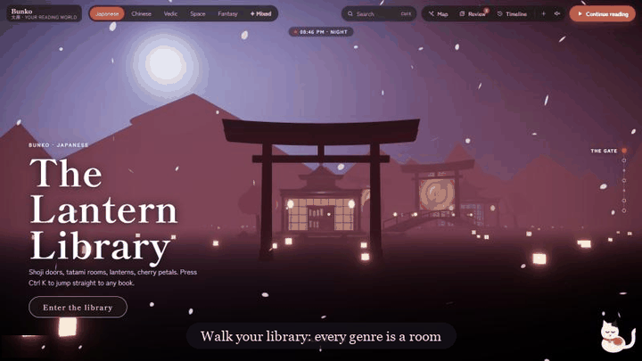

# Bunko 文庫

**A library you can walk into, read in, and talk to, and it never spoils the ending.**

<p align="center">
  
  <br>
  <sub>Walk the rooms &nbsp;·&nbsp; ask with citations, no spoilers &nbsp;·&nbsp; see how your books connect</sub>
</p>

Bunko turns your bookshelf into a place. Every genre becomes a room in a 3D world: a lantern-lit Japanese tea house, a Vedic ashram under a banyan tree, a library station orbiting a black hole. Take a book off the shelf and it floats down and opens into a reading room that matches its world.

Then the clever part. Ask *"why does Elizabeth dislike Darcy?"* and Bunko answers from **your** book, quotes the exact lines, and opens the page when you click a citation. It only knows what you've read so far: no twists, no endings, no "well, actually, in chapter 40…". Finish a chapter and a reading partner asks what you thought, and pushes back with quotes when it disagrees. Highlight a line and it comes back days later, just before you'd forget it. Every idea you meet joins a star map that shows which of your books are secretly talking to each other.

It's a reading app, a spoiler-proof AI, a memory trainer and a constellation of everything you've read, in one place.

---

## What it does

- **Walk your library.** Scroll through 3D rooms, one per genre. Pick a theme (Japanese, Chinese, Vedic, Space, Fantasy) or Mixed, where each genre is built in its own culture. The light follows your real time of day, and the library visibly grows as you add genres and finish books.
- **Read beautifully.** EPUB and PDF in an open-book reading room, with page turns, day, dusk and night paper, typefaces, and your place saved. `Ctrl K` jumps to any book or passage.
- **Ask, spoiler-free.** Hybrid search (meaning plus keywords, then reranking) over your books, filtered to the pages you've reached. Every claim is cited, and a leak check hides names you haven't met yet.
- **Discuss.** A reading partner opens the conversation about what you just read and argues with evidence.
- **Remember.** Highlights and notes become spaced-repetition cards (FSRS), searchable by meaning: *"what did I find important about anger?"*
- **Connect.** A knowledge graph of ideas and people across books, with *"where do these books agree?"* comparisons and a 3D **reading map** of your stars and your gaps.
- **Plug into Claude.** An MCP server lets Claude Desktop, Claude Code or Cursor search your library and highlights.
- **Sound, if you like.** Soft ambience per theme (wind chimes, a temple drone, a station hum), all generated in the browser.

## Tech

| | |
|---|---|
| **Web** | Next.js 16, React 19, TypeScript, Tailwind, React Three Fiber, drei, postprocessing, Motion, epub.js, pdf.js, Web Audio |
| **API** | FastAPI, SQLAlchemy (SQLite or Postgres), Redis and RQ for background jobs |
| **AI** | Qdrant (dense + BM25, RRF fusion), local ONNX models via fastembed, a jina reranker, LangGraph, Gemini (Groq as an automatic backup), MCP |
| **Ops** | Docker Compose, pytest, a hand-written evaluation set |

## Run it

You need Python 3.12 and Node 20+.

```bash
# 1. API (port 8010)
cd apps/api
python -m venv .venv
.venv/Scripts/pip install -r requirements.txt        # macOS/Linux: .venv/bin/pip
cp .env.example .env                                  # add a free Gemini key (and optionally Groq)
.venv/Scripts/python -m uvicorn app.main:app --port 8010
```

```bash
# 2. Web (port 3000)
cd apps/web
npm install
npm run dev
```

Open http://localhost:3000. On first start the API downloads two small search models (~250 MB) and indexes your books in the background. No AI key? It still works, and answers with the cited passages themselves.

**Want some books to start with?** With the API running, `cd apps/api && .venv/Scripts/python -m app.seed` adds a shelf of public-domain classics from Project Gutenberg.

**Everything in Docker:** `docker compose up --build` (web on 3000, API on 8010; keys are read from `apps/api/.env`).

## Project layout

```
apps/
  api/                    FastAPI backend
    app/
      routes/             HTTP endpoints: books, library, ask, highlights, graph
      ingest/             EPUB/PDF parsing and chunking (every passage knows its page)
      rag/                search, spoiler limits, answers, discussion partner, LLM clients
      graph.py            knowledge-graph builder
      review.py           FSRS spaced repetition
    eval/                 evaluation questions, runner and latest results
    mcp_server.py         MCP server for Claude and other AI apps
    tests/
  web/                    Next.js app
    src/
      app/                routes: / (library), /read/[id], /map
      library/            the 3D world: themes, rooms, shelves, book cards, librarian
      reader/             reading room: EPUB/PDF views, highlights
      map/                reading map (3D star chart)
      components/         shared UI: chat panel, search, dropdowns, icons
      lib/                API client, sound engine
      styles/             CSS by area
docs/SPEC.md              the original design spec
docs/media/               the demo GIF
prototypes/theme-demos/   Phase 1 theme prototypes (Vite)
docker-compose.yml
```

## Tests and evaluation

```bash
cd apps/api && .venv/Scripts/python -m pytest      # 34 tests, no API key needed
cd apps/api && .venv/Scripts/python -m ruff check .  # lint
cd apps/api && .venv/Scripts/python eval/run_eval.py   # spoiler leaks, citations, recall (needs the API running)
```

18 hand-written questions across 6 books, each asked by a reader stopped partway through, including 4 traps whose answer only appears later in the book. The same questions are asked with Bunko's spoiler-safe search and again without it:

| | Bunko | Without the protection |
|---|---|---|
| Answers that spoiled something | **0 / 18** | 3 / 18 |
| Spoiler traps declined | **4 / 4** | 1 / 4 |
| Answers backed by the right passage | **100%** | 7% |
| Answer passage found (top 8) | **100%** | 79% |

Full table: [apps/api/eval/RESULTS.md](apps/api/eval/RESULTS.md).

## Use it from Claude (MCP)

```bash
claude mcp add bunko -- <path>/apps/api/.venv/Scripts/python.exe <path>/apps/api/mcp_server.py
```

For Claude Desktop, add the same command and argument under `mcpServers` → `bunko` in its config. The API must be running.
